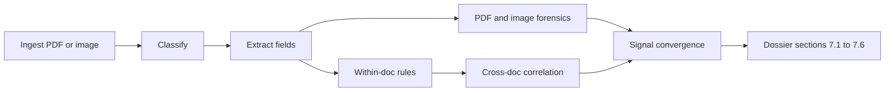

# PS-2 audit and gap-closure plan

## Audit against [PS-2.pdf](C:\Users\kaiva\Downloads\PS-2.pdf)

The working prototype in this repo already covers the mandatory flow in sections 3 and 6 for a four-document Indian KYC bundle: ingest PDF and images, classify, extract fields with confidence and 150 DPI boxes, within-document rules, cross-document name/DOB/PAN/salary checks, PDF-native forensics, weak image signals, evidence jump in the UI, human review, hash-chained audit, and a ReportLab dossier. Safety language matches section 13: advisory only, no “fraud” verdicts, synthetic data, PII masking.

Estimated judging position if demonstrated as-is (section 11, 100 points):

- OCR and extraction (15): strong on these four printed types and the synthetic suite in [docs/RESULTS_TABLE.md](docs/RESULTS_TABLE.md). Handwriting is correctly unsupported (bonus in section 6). Risk is that 100% accuracy is only on generator-matched samples.
- Document understanding (15): keyword classifier in [backend/app/services/classification.py](backend/app/services/classification.py) plus label-line parsers in [backend/app/services/extraction/field_parser.py](backend/app/services/extraction/field_parser.py). Missing, duplicate, and misplaced checks exist in [backend/app/services/rules/within_doc.py](backend/app/services/rules/within_doc.py). No general layout model (that item is bonus).
- Visual forensics (15): font family, font size, metadata, incremental `%%EOF`, hidden text, and text-layer vs OCR are implemented in [backend/app/services/forensics/pdf_native.py](backend/app/services/forensics/pdf_native.py). ELA and copy-move stay weak observations. Signature analysis required by sections 5.4 and 7.4 is absent. Spacing and baseline alignment are only partly covered by the same-row font-size check.
- Contextual intelligence (20): highest-weight item, and the narrowest. [backend/app/services/correlation/cross_doc.py](backend/app/services/correlation/cross_doc.py) compares identity and salary credits only. Application forms, transaction requests, and declarations from the PDF’s category list are unsupported, so conflicts that only appear across those categories cannot be shown.
- Evidence and traceability (10): solid. Findings carry `(doc_id, page, bbox)`, the UI jumps to the highlight, and the dossier crops thumbnails.
- AI reasoning and explainability (10): templates in [backend/app/services/explanation.py](backend/app/services/explanation.py) are applied at ingest, and they stay inside the offline rule-based decision (no cloud LLM). The dossier never calls `generate_investigation_summary`, and findings are not linked to each other even though section 10 asks judges to see how findings relate. Escalation in [backend/app/services/escalation.py](backend/app/services/escalation.py) already detects spatially overlapping signals but does not record that link.
- Technical implementation (10): architecture, offline mode, tests, and failure states are in place.
- Innovation (5): Aadhaar QR vs print, prompt-injection quarantine, and the hash-chained ledger are the differentiators. Keep them.

Deliverable gaps versus section 9:

- Sample investigation dossier is generated at runtime only. [backend/app/services/dossier.py](backend/app/services/dossier.py) does not use the section 7 headings. It has a summary table, a document list, findings grouped by tier, a priority breakdown, and an audit tail. It does not have a field-level extracted-information section, a split between contextual and visual findings, or the investigation summary that already exists in code.
- Sections 7.1–7.6 are therefore only partially met.
- Capabilities, limitations, architecture, and demo script exist and should be updated after the new types land, not rewritten.

Out of scope, and to stay documented as unsupported or partial: handwriting, multilingual OCR, UIDAI PKI, biometric signature comparison, a general layout model, and cloud or local LLM narratives.

## 1. Three new document types

Add enum values on `DocumentType` in [backend/app/models/contracts.py](backend/app/models/contracts.py) and the TypeScript mirror in [frontend/src/types/contracts.ts](frontend/src/types/contracts.ts):

- `loan_application` — application form. Fields: `name`, `dob`, `pan_number`, `declared_monthly_income`, `loan_amount`, `purpose`.
- `declaration_15g` — declaration. Fields: `name`, `pan_number`, `financial_year`, `estimated_annual_income`, `declaration_date`.
- `payment_instruction` — transaction request (NEFT-style). Fields: `name`, `account_number`, `beneficiary_name`, `amount`, `instruction_date`, `purpose`.

Use the field name `name` so the existing pairwise name loop in `CrossDocEngine` picks the new documents up without a second matcher.

Wire each type through the same path the four current types use:

- Keywords and regex in [backend/app/services/classification_config.json](backend/app/services/classification_config.json).
- Label-line extractors next to `extract_salary_slip_fields`, dispatched from `parse_document_fields`.
- Mandatory-field lists in `within_doc.py`.
- Branch in `execute_document_rules` only where a within-document numeric check is needed (loan amount present and positive; payment amount present). Identity conflicts stay in the cross-document engine.

Cross-document checks to add in [backend/app/services/correlation/cross_doc.py](backend/app/services/correlation/cross_doc.py), each with two-sided evidence boxes and new rows in the comparison matrix:

- Loan PAN and DOB against the PAN card; declared monthly income against salary-slip gross, with a fixed rupee tolerance. A large gap is an inconsistency, not a manipulation tier, unless a forensic signal lands on the same region.
- Form 15G PAN against the PAN card. Compare `estimated_annual_income` with salary gross times 12. Flag when the declaration is materially below demonstrated pay.
- Payment instruction account number and remitter name against the bank statement. Flag when the instructed amount has no matching debit in `transactions`.

Add points for the new rule ids in `RULE_POINTS_MATRIX` and short `why_it_matters` / `next_steps` entries in `EXPLANATION_TEMPLATES`. Wording stays advisory and must not use the forbidden terms already listed in `explanation.py`.

## 2. Synthetic bundles

Extend [samples/generate_samples.py](samples/generate_samples.py) with generators for the three forms, using the same fictional persona as the existing genuine bundles.

- One genuine bundle that includes the current four documents plus the three new ones, all consistent, and with a drawn signature mark under each “Signature” label (a ReportLab path, not a real signature image).
- Three tampered bundles, one conflict each: inflated `declared_monthly_income` versus the salary slip; Form 15G PAN or estimated income disagreeing with the PAN card and salary; payment amount or account absent from the bank statement.

Keep existing `genuine_0x` and `tampered_0x` bundles unchanged so current tests stay valid. Extend [eval/run_eval.py](eval/run_eval.py) expectations for the new bundles and regenerate [docs/RESULTS_TABLE.md](docs/RESULTS_TABLE.md) from that run. The published accuracy must match the synthetic suite after the new cases, including any genuine-bundle false positives that have to be tuned out.

## 3. Signature presence and alignment

Add `check_signature_region` in [backend/app/services/forensics/pdf_native.py](backend/app/services/forensics/pdf_native.py), called from `execute_forensics_checks` for PDFs that contain a “signature” or “authorised signatory” label:

- Locate the label span, then inspect the rendered page crop beneath it for dark stroke pixels.
- No stroke under the label becomes an observation: signature region empty.
- A stroke that overlaps a data field bbox becomes an observation: signature placement overlaps extracted content.
- Do not compare signature shapes. Record this limit in [docs/CAPABILITIES.md](docs/CAPABILITIES.md) and [docs/LIMITATIONS.md](docs/LIMITATIONS.md).

Add one alignment observation beside the existing font checks: spans that share a text line (similar y, not the same span) but whose baseline differs by more than about 3 points and less than a full line. Emit at most one finding per line so genuine ReportLab output does not flood the dossier. Confirm `genuine_01` through `genuine_05` still produce no findings.

## 4. Link related findings

`EscalationEngine.escalate_findings` already detects overlapping signals. When two or more findings converge, set `related_finding_ids` on each of them (new optional list on `Finding` in the Python and TypeScript contracts). Show that list on the finding card in [frontend/src/components/FindingCard.tsx](frontend/src/components/FindingCard.tsx) and as a short “Related findings” line in the dossier. This is the checklist item “how the system establishes relationships between different findings.” Single-signal findings keep an empty list. Tier rules stay as they are: weak image signals alone never leave Observation.

## 5. Dossier sections 7.1–7.6

Restructure `generate_dossier` so the PDF headings match section 7, using data already on `Investigation`, `DocumentRecord`, and `Finding`:

- 7.1 Document overview: per document id, filename, type, page count, SHA-256, processing status.
- 7.2 Extracted information: field name, value (PII-masked for Aadhaar and PAN using the existing mask helpers), confidence, source, page, and bbox.
- 7.3 Contextual analysis: findings whose category is `within_document` or `cross_document`.
- 7.4 Visual forensic findings: category `forensic` and `injection`, including signature and alignment observations.
- 7.5 Evidence and traceability: keep the current bbox lines and thumbnail crops, grouped with the finding they support.
- 7.6 Investigation summary: call the existing `generate_investigation_summary` instead of leaving it unused. Keep the priority breakdown and the audit-trail tail after 7.6.

Also write one generated sample, from a tampered bundle, to `docs/sample_dossier.pdf` so deliverable 3 in section 9 is in the repo.

## 6. UI labels, capabilities, and docs

The cross-document screen already renders whatever matrix the API returns, so new comparison rows appear without a new screen. Update document-type labels wherever the UI prints `type`, the capabilities payload in [backend/app/main.py](backend/app/main.py), [docs/CAPABILITIES.md](docs/CAPABILITIES.md), [docs/LIMITATIONS.md](docs/LIMITATIONS.md), the architecture diagram, and a short extra beat in [docs/DEMO_SCRIPT.md](docs/DEMO_SCRIPT.md) for the loan, 15G, and payment conflicts.

## Tests

- Classification of the three new texts, including a low-score fallback to `unsupported`.
- Each new cross-document rule: one fail and one pass.
- Signature empty versus signature stroke present.
- Dossier PDF text contains the six section headings and the investigation summary.
- Existing checkpoint tests still pass, and the genuine bundles still score as true negatives.
