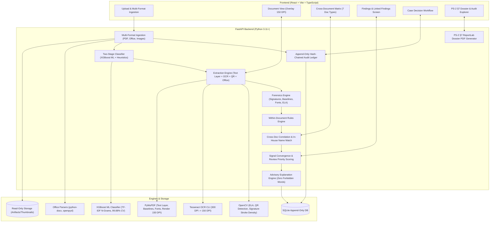

# System Architecture

## Overview
The AI Document Forensics and Contextual Intelligence System is an offline, deterministic, evidence-linked verification pipeline designed for high-assurance forensic investigation of Indian identity and financial document bundles (Aadhaar, PAN, Salary Slips, Bank Statements, Loan Applications, Form 15G Declarations, and Payment Instructions).

## Core Architectural Modules

1. **Multi-Format Ingestion & Integrity**:
   - Accepts `.pdf`, `.docx`, `.xlsx`, `.png`, `.jpg`, `.jpeg`, `.tiff`, `.tif`, `.bmp`, and `.webp` with strict HTTP 422 rejection of unsupported formats.
   - Calculates cryptographic SHA-256 on ingest, stores pristine source files as read-only, renders server-side to uniform 150 DPI PNGs, and logs an immutable audit event.
2. **Two-Stage Document Classification**:
   - Primary stage: Supervised **XGBoost ML classifier** trained over TF-IDF n-grams (99.88% 5-fold CV accuracy across 846+ training samples).
   - Fallback stage: Deterministic keyword, regular expression, and layout marker engine. Supports 7 distinct document classes with graceful fallback to `unsupported`.
3. **Extraction & Normalization**:
   - Vector PDFs extracted via PyMuPDF (`text_layer`), extracting text spans, bounding boxes, font names, sizes, and baseline origins.
   - Scanned pages rasterized to 300 DPI and processed via local Tesseract CLI (`ocr`), normalized to standard 150 DPI coordinate geometry.
   - Office documents parsed natively via `python-docx` and `openpyxl`, synthesized to PDF/PNG for visual consistency.
   - Aadhaar Secure QR codes decoded via OpenCV and pure Python zlib/big-integer unpacking (`qr`).
4. **Deterministic Validation Rules**:
   - Within-document structural rules (missing mandatory fields, conflicting duplicates, misplaced headers).
   - Domain-specific arithmetic: Verhoeff checksum ($D_5$ group), PAN structure & surname check, payroll components to gross/net pay, bank transaction running balance continuity, and loan/payment positive amount validation.
5. **Cross-Document Correlation Engine**:
   - Multi-document matching across shared entities (Name, DOB, PAN, Salary Credits, Form 15G, and Payment Instructions).
   - In-house Indian phonetic and token-permutation matcher (Levenshtein + Jaro-Winkler + honorific stripping + initial expansion).
   - Generates two-sided bounding box evidence pairs and populates the Cross-Document Comparison Matrix.
6. **Visual & Structural Forensics**:
   - Signature presence & stroke density verification (`signature_region_empty`) and field boundary overlap detection (`signature_placement_overlap`).
   - Baseline alignment anomaly detection (`baseline_alignment_anomaly`) across row spans.
   - PyMuPDF span-level font family and size inconsistency detection.
   - Incremental `%%EOF` re-save counters, metadata editing software signatures, and vector text vs OCR overlay diffing.
   - Error Level Analysis (ELA) and copy-move detection treated strictly as weak supporting observations.
7. **Adversarial Instruction Defense**:
   - Proactive scanning for prompt-injection patterns in visible and hidden layers, isolating adversarial strings so they cannot alter scoring or grant unauthorized approval.
8. **Signal Convergence & Review Priority Scoring**:
   - Detects spatial overlap between independent signals (e.g. visual font anomaly + cross-document numeric discrepancy on the same field), escalating finding tiers and populating `related_finding_ids`.
   - Calculates deterministic review priority (Low: 0–29, Medium: 30–69, High: $\ge 70$) from a transparent points table.
9. **Deterministic Explanation Engine**:
   - Parameterized string templates strictly bound to extracted field evidence. Strictly prohibits accusatory terms (*fraud*, *forged*, *fake*, *counterfeit*, *criminal*).
10. **Human Review & Decision Core**:
    - Enforces advisory operation. Reviewers can confirm, escalate, or dismiss (with mandatory reason) individual findings.
    - Final Case Decision recorded by human investigator (`rely_on_tool_output`, `partially_rely`, `disregard_tool_output`, `needs_more_information`).
11. **Cryptographic Audit Ledger**:
    - Sequential SHA-256 hash chaining of canonical JSON records in SQLite. Retrospective row alteration breaks the chain and is detected via `/audit/verify`.
12. **PS-2 Section 7 Dossier PDF Export**:
    - ReportLab PDF generator producing high-assurance dossiers strictly following PS-2 §7 headings (§7.1 Document Overview, §7.2 Extracted Information with PII masking, §7.3 Contextual Analysis, §7.4 Visual Forensic Findings, §7.5 Evidence and Traceability with cropped thumbnails, and §7.6 Investigation Summary). Watermarked `DRAFT` until a human case decision is submitted.
