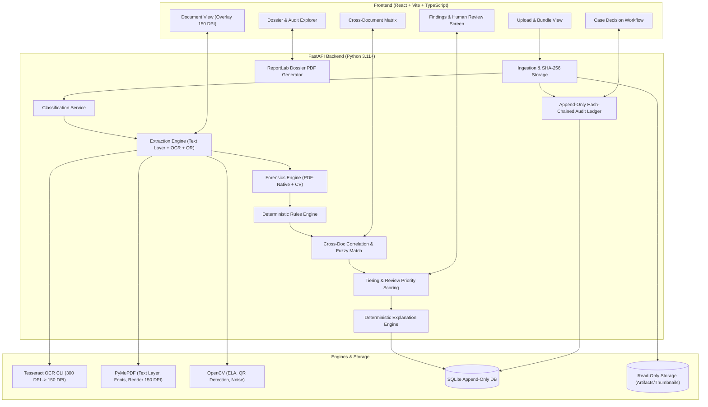

# System Architecture

## Overview
The AI Document Forensics and Contextual Intelligence System is an offline, deterministic, evidence-linked verification pipeline designed for high-assurance forensic investigation of Indian identity and financial document bundles (Aadhaar, PAN, Salary Slips, Bank Statements).

## Core Architectural Modules

1. **Ingestion & Integrity**: Calculates cryptographic SHA-256 on ingest, stores pristine files as read-only, logs immutable audit entry.
2. **Classification**: Layout and keyword heuristic classifier categorizing documents into Aadhaar, PAN, Salary Slip, Bank Statement, or gracefully falling back to Unsupported.
3. **Extraction & Normalization**:
   - Vector PDFs extracted via PyMuPDF (source: `text_layer`).
   - Scanned pages rasterized to 300 DPI and processed via Tesseract CLI (source: `ocr`), with bounding boxes normalized to standard 150 DPI render space.
   - Aadhaar Secure QR codes decoded via OpenCV and pure Python zlib/big-integer unpacking (source: `qr`).
4. **Deterministic Validation Rules**: Pure functional checks (Verhoeff, PAN structure, salary arithmetic, bank running balance continuity, date plausibility).
5. **Cross-Document Correlation**: Multi-document matching on shared entities (Name, DOB, PAN, Salary Credit vs Net Pay) utilizing an in-house Indian phonetic and token-permutation matcher.
6. **PDF-Native Forensics**: PyMuPDF span-level font/size inspection, incremental `%%EOF` re-save counters, metadata editing-software detection, and vector text vs OCR overlay diffing.
7. **Adversarial Instruction Defense**: Proactive scanning for prompt-injection patterns in visible and hidden layers, isolating adversarial strings from scoring.
8. **Three-Tier Escalation & Review Priority**: Strict classification into `Observation`, `Inconsistency`, and `Potential manipulation` (requiring $\ge 2$ independent signal types). Review priority calculated from a transparent points table.
9. **Deterministic Explanation Generator**: Parameterized string templates strictly bound to extracted field evidence; zero hallucination, zero prohibited terms.
10. **Human Review & Decision Core**: Enforces advisory operation. Dossiers are watermarked `DRAFT` until a human reviewer records a binding Case Decision.
11. **Cryptographic Audit Ledger**: Sequential SHA-256 hash chaining of canonical JSON records to detect retrospective database tampering.
