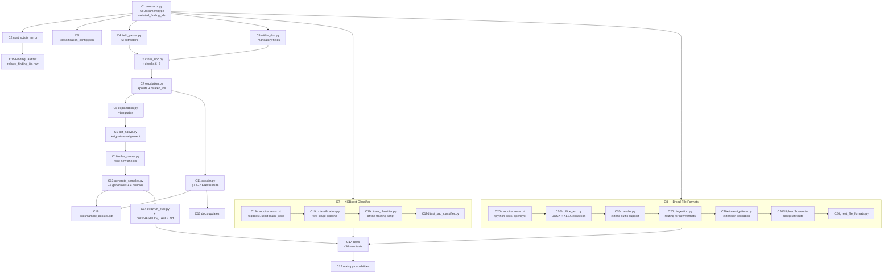

# PS-2 Audit & Gap-Closure Implementation Plan

## Goal

Close eight gaps in the PS-2 prototype to maximise the judging score (targeting ~85–90/100):

| Gap | Judging section | Current state | Target |
|---|---|---|---|
| **G1** Three new document types | Contextual intelligence (20 pts) | 4 doc types | 7 doc types + 3 new cross-doc checks |
| **G2** Synthetic bundles | Deliverable §9 | 5 genuine + 8 tampered | +1 genuine + 3 tampered + eval update |
| **G3** Signature & baseline alignment | Visual forensics (15 pts) | Missing | Observation-tier checks added |
| **G4** Related findings linkage | AI reasoning / explainability (10 pts) | Signals detected, not surfaced | `related_finding_ids` on Finding + UI card + dossier |
| **G5** Dossier §7.1–7.6 | Deliverables §9 | 4 of 6 sections | All 6 sections + sample PDF committed |
| **G6** Tests & docs | Technical implementation (10 pts) | 64 tests passing | +~20 new tests; docs updated |
| **G7** XGBoost ML classifier | Document understanding (15 pts) | Keyword/regex only | XGBoost trained on `data/originals/` as primary classifier; heuristic as fallback |
| **G8** Broad file-format ingestion | Technical implementation (10 pts) | PDF + PNG/JPG only | Add DOCX, XLSX, scanned PDF/image support |

---

## User Review Required

> [!IMPORTANT]
> **New field name on salary slip**: The spec says new doc types use `name` as the holder field so the existing cross-doc name loop picks them up automatically. The salary slip currently uses `employee_name` (not `name`) and is handled by an explicit alias on line 75 of `cross_doc.py`. All three new types will emit `name` — confirm this is intentional so the alias line can be **removed** to keep the loop clean.

> [!IMPORTANT]
> **Income tolerance for 15G / loan checks**: The spec says "fixed rupee tolerance" for declared vs gross monthly income. I propose **INR 500** for the loan check and **10% of annual gross** for the 15G annual check. Please confirm or adjust before implementation.

> [!WARNING]
> **Dossier restructure is a non-additive change**: `generate_dossier` in `dossier.py` will be rewritten (not patched). The API endpoint contract and PDF filename pattern are unchanged, but the internal heading structure changes substantially. Existing snapshot tests that check PDF text content will need updating.

> [!NOTE]
> **Sample dossier committed as `docs/sample_dossier.pdf`**: Generated from `tampered_11_income_inflate` at plan execution time. This is a binary file; it will be regenerated on every `generate_samples.py` run if the bundle changes.

> [!IMPORTANT]
> **XGBoost cold-start**: On first deployment, `xgb_classifier.pkl` will not exist. The ingestion pipeline must fall back to the existing heuristic classifier seamlessly. The model is trained on-demand via `python backend/scripts/train_classifier.py` and committed as a binary artifact.

> [!WARNING]
> **DOCX / XLSX require `python-docx` and `openpyxl`** — both are pure Python and install cleanly on Python 3.14. Add them to `requirements.txt`. Scanned PDF support already works via the existing Tesseract OCR fallback path in `ingestion.py`.

---

## Open Questions

> [!IMPORTANT]
> Should `payment_instruction` check the **remitter** name against the bank statement `account_holder` field, or only the beneficiary?  
> The spec says "remitter name against bank statement" — I'll check `account_holder` (remitter = account owner). If that is wrong, let me know.

> [!IMPORTANT]
> The spec asks for "a drawn signature mark" using a ReportLab path under each `Signature` label in generated PDFs. Should the **genuine** bundles also receive a signature stroke, or only the new 7-document bundle?  
> I'll add signature strokes to all generators that have a `Signature` label (loan app, 15G, payment instruction). Existing 4-doc bundles are unaffected.

---

## Proposed Changes

---

### Component 1 — Python contracts (`backend/app/models/contracts.py`)

#### [MODIFY] contracts.py

Add three enum values and add `related_finding_ids` to `Finding`:

```python
class DocumentType(str, Enum):
    AADHAAR          = "aadhaar"
    PAN              = "pan"
    SALARY_SLIP      = "salary_slip"
    BANK_STATEMENT   = "bank_statement"
    LOAN_APPLICATION = "loan_application"   # NEW
    DECLARATION_15G  = "declaration_15g"    # NEW
    PAYMENT_INSTRUCTION = "payment_instruction"  # NEW
    UNSUPPORTED      = "unsupported"

class Finding(BaseModel):
    ...existing fields...
    related_finding_ids: List[str] = []     # NEW – set by EscalationEngine
```

---

### Component 2 — TypeScript mirror (`frontend/src/types/contracts.ts`)

#### [MODIFY] contracts.ts

```ts
export type DocumentType =
  | 'aadhaar'
  | 'pan'
  | 'salary_slip'
  | 'bank_statement'
  | 'loan_application'       // NEW
  | 'declaration_15g'        // NEW
  | 'payment_instruction'    // NEW
  | 'unsupported';

export interface Finding {
  ...existing fields...
  related_finding_ids: string[];   // NEW
}
```

---

### Component 3 — Classification config (`backend/app/services/classification_config.json`)

> [!NOTE]
> The heuristic config remains the **cold-start fallback** when `xgb_classifier.pkl` is absent or when XGBoost confidence < 0.60. The three new type entries must be added here to cover that path.

#### [MODIFY] classification_config.json

Add three top-level keys alongside the existing four:

```json
"loan_application": {
  "keywords": [
    "loan application", "applicant name", "declared monthly income",
    "loan amount", "purpose of loan", "co-applicant", "repayment tenure"
  ],
  "regex": [
    "loan\\s+amount[:\\s]+[\\d,]+",
    "declared\\s+(?:monthly|annual)\\s+income"
  ],
  "min_score": 25
},
"declaration_15g": {
  "keywords": [
    "form 15g", "15g", "declaration under section 197a",
    "estimated annual income", "financial year", "tax deduction",
    "previous year income"
  ],
  "regex": [
    "form\\s+15\\s*[Gg]",
    "\\b197[Aa]\\b"
  ],
  "min_score": 25
},
"payment_instruction": {
  "keywords": [
    "payment instruction", "neft", "rtgs", "fund transfer",
    "beneficiary name", "beneficiary account", "ifsc code",
    "instruction date", "remitter"
  ],
  "regex": [
    "neft|rtgs|imps",
    "beneficiary\\s+account\\s+number"
  ],
  "min_score": 25
}
```

---

### Component 4 — Field extraction (`backend/app/services/extraction/field_parser.py`)

#### [MODIFY] field_parser.py

Add three extractor functions and wire them into `parse_document_fields`:

**`extract_loan_application_fields(doc_id, pages_data)`**
- `name` — regex `Applicant Name[:\s]+([A-Za-z\s]+)`
- `dob` — regex `(?:DOB|Date of Birth)[:\s]+(\d{2}[/-]\d{2}[/-]\d{4})`
- `pan_number` — regex `PAN[:\s]+([A-Z]{5}[0-9]{4}[A-Z])`
- `declared_monthly_income` — regex `Declared Monthly Income[:\s]+([\d,]+)`
- `loan_amount` — regex `Loan Amount[:\s]+([\d,]+)`
- `purpose` — regex `Purpose[:\s]+([^\n]+)`

**`extract_declaration_15g_fields(doc_id, pages_data)`**
- `name` — regex `Name[:\s]+([A-Za-z\s]+)`
- `pan_number` — regex `\b([A-Z]{5}[0-9]{4}[A-Z])\b`
- `financial_year` — regex `Financial Year[:\s]+(\d{4}-\d{2,4})`
- `estimated_annual_income` — regex `Estimated Annual Income[:\s]+([\d,]+)`
- `declaration_date` — regex `Date[:\s]+(\d{2}[/-]\d{2}[/-]\d{4})`

**`extract_payment_instruction_fields(doc_id, pages_data)`**
- `name` — regex `Remitter Name[:\s]+([A-Za-z\s]+)` (alias `name`)
- `account_number` — regex `(?:Remitter )?Account Number[:\s]+([\dXx]+)`
- `beneficiary_name` — regex `Beneficiary Name[:\s]+([A-Za-z\s]+)`
- `amount` — regex `Amount[:\s]+([\d,]+(?:\.\d{2})?)`
- `instruction_date` — regex `(?:Instruction )?Date[:\s]+(\d{2}[/-]\d{2}[/-]\d{4})`
- `purpose` — regex `Purpose[:\s]+([^\n]+)`

Dispatch in `parse_document_fields`:
```python
elif doc_type == DocumentType.LOAN_APPLICATION:
    fields = extract_loan_application_fields(doc_id, pages_data)
elif doc_type == DocumentType.DECLARATION_15G:
    fields = extract_declaration_15g_fields(doc_id, pages_data)
elif doc_type == DocumentType.PAYMENT_INSTRUCTION:
    fields = extract_payment_instruction_fields(doc_id, pages_data)
```

---

### Component 5 — Within-document rules (`backend/app/services/rules/within_doc.py`)

#### [MODIFY] within_doc.py

Extend `MANDATORY_FIELDS` and add numeric presence checks:

```python
MANDATORY_FIELDS = {
    ...existing...,
    DocumentType.LOAN_APPLICATION:    ["name", "declared_monthly_income", "loan_amount"],
    DocumentType.DECLARATION_15G:     ["name", "pan_number", "estimated_annual_income"],
    DocumentType.PAYMENT_INSTRUCTION: ["name", "amount", "beneficiary_name"],
}
```

Add after the existing checks in `validate_within_document_structure`:

```python
# Loan: loan_amount > 0
if doc_type == DocumentType.LOAN_APPLICATION:
    la_field = next((f for f in fields if f.name == "loan_amount"), None)
    if la_field and (la_field.value is None or float(la_field.value or 0) <= 0):
        results.append(RuleResult(rule_id="loan_amount_invalid", ...))

# Payment: amount > 0
if doc_type == DocumentType.PAYMENT_INSTRUCTION:
    amt_field = next((f for f in fields if f.name == "amount"), None)
    if amt_field and (amt_field.value is None or float(amt_field.value or 0) <= 0):
        results.append(RuleResult(rule_id="payment_amount_invalid", ...))
```

---

### Component 6 — Cross-document correlation (`backend/app/services/correlation/cross_doc.py`)

#### [MODIFY] cross_doc.py

The existing name-loop already iterates all `name` fields — the three new types automatically participate.

Add three new check blocks after the existing five:

**Check 6: Loan vs PAN + Salary**
```
loan_doc = doc_by_type.get(DocumentType.LOAN_APPLICATION)
if loan_doc and pan_doc:
    compare loan pan_number vs pan doc pan_number (exact match → INCONSISTENCY if mismatch)
    compare loan dob vs pan dob (exact match via are_dates_equal → INCONSISTENCY if mismatch)
if loan_doc and slip_doc:
    compare declared_monthly_income vs gross (tolerance: INR 500)
    gap > 500 → INCONSISTENCY "Declared income vs salary gross discrepancy"
    gap > 500 AND forensic signal on same region → escalation engine handles
```

**Check 7: 15G vs PAN + Salary**
```
g15_doc = doc_by_type.get(DocumentType.DECLARATION_15G)
if g15_doc and pan_doc:
    compare 15G pan_number vs pan pan_number (exact → INCONSISTENCY if mismatch)
if g15_doc and slip_doc:
    gross_annual = gross * 12
    declared = estimated_annual_income
    if declared < gross_annual * 0.90:   # materially below 10% threshold
        INCONSISTENCY "Form 15G annual income materially below demonstrated salary"
```

**Check 8: Payment instruction vs Bank statement**
```
pmt_doc = doc_by_type.get(DocumentType.PAYMENT_INSTRUCTION)
if pmt_doc and bank_doc:
    compare pmt account_number vs bank account_number
    if mismatch → OBSERVATION "Payment instruction account differs from bank statement"
    compare pmt name vs bank account_holder (name_match → conflict/needs_review)
    check if pmt.amount appears as a debit in bank transactions (tolerance INR 1)
    if not found → INCONSISTENCY "Instructed payment amount not reflected in bank debits"
```

Each new check adds a row to `comparison_matrix` with two-sided doc/bbox evidence.

---

### Component 7 — Escalation & scoring (`backend/app/services/escalation.py`)

#### [MODIFY] escalation.py

**Add rule points** to `RULE_POINTS_MATRIX`:
```python
"loan_income_vs_salary":        20,
"loan_pan_mismatch":            20,
"loan_dob_mismatch":            20,
"g15_income_vs_salary":         20,
"g15_pan_mismatch":             20,
"payment_amount_not_in_bank":   25,
"payment_account_mismatch":     10,
"payment_amount_invalid":        5,
"loan_amount_invalid":           5,
"signature_region_empty":        5,
"signature_placement_overlap":  10,
"baseline_alignment_anomaly":   10,
```

**Add `related_finding_ids`** in `escalate_findings`:
```python
# After computing converging findings for f1:
if len(converging_signals) >= 2 and len(non_weak_signals) >= 2:
    f1.tier = FindingTier.POTENTIAL_MANIPULATION
    f1.related_finding_ids = [
        escalated_list[j].finding_id
        for j in range(len(escalated_list)) if j != i
        and <spatial convergence check>
    ]
# For single-signal convergence, still record related ids even if tier unchanged:
elif len(converging_signals) >= 2:
    f1.related_finding_ids = [...]
```

---

### Component 8 — Explanation templates (`backend/app/services/explanation.py`)

#### [MODIFY] explanation.py

Add to `EXPLANATION_TEMPLATES`:
```python
"loan_income_vs_salary": {
    "why_it_matters": "...",
    "next_steps": "..."
},
"loan_pan_mismatch": { ... },
"loan_dob_mismatch": { ... },
"g15_income_vs_salary": { ... },
"g15_pan_mismatch": { ... },
"payment_amount_not_in_bank": { ... },
"payment_account_mismatch": { ... },
"signature_region_empty": { ... },
"signature_placement_overlap": { ... },
"baseline_alignment_anomaly": { ... },
```

---

### Component 9 — PDF-native forensics (`backend/app/services/forensics/pdf_native.py`)

#### [MODIFY] pdf_native.py

**Add `check_signature_region(doc_path, doc_id, rendered_pages_dir)`**:
1. Open the PDF with PyMuPDF; scan every page for a text span whose lowercased text contains `"signature"` or `"authorised signatory"`.
2. For each such label span, derive a crop bbox: same x-width as the label, 20–60 pt below the label baseline.
3. Read the rendered 150 DPI PNG for that page; crop the region.
4. Count dark pixels (mean pixel value < 180 in grayscale).
5. If dark_pixel_ratio < 0.002 → emit `Finding(rule_id="signature_region_empty", tier=OBSERVATION, strength=WEAK)`.
6. If the crop bbox overlaps any extracted field bbox → emit `Finding(rule_id="signature_placement_overlap", tier=OBSERVATION, strength=WEAK)`.

**Add `check_baseline_alignment(doc_path, doc_id)`**:
1. For each page, group spans into lines (spans whose `bbox[1]` values differ by < 3 pt).
2. Within each line group, check if any two spans have `|baseline1 - baseline2| > 3 and < line_height`.
3. Emit at most **one** finding per logical line (first offending pair only).
4. Skip lines with only one span.

**Wire both into `execute_forensics_checks`** in `rules_runner.py`:
```python
if suffix == ".pdf":
    ...existing checks...
    findings.extend(check_signature_region(doc_file_path, doc.doc_id, rendered_dir))
    findings.extend(check_baseline_alignment(doc_file_path, doc.doc_id))
```

> [!NOTE]
> `execute_forensics_checks` currently does not receive `rendered_dir`. It receives `rendered_pages: List[Path]`. Pass `rendered_pages[0].parent` as the rendered dir for the signature check, or accept rendered pages directly and derive the crop from pre-loaded images.

---

### Component 10 — Rules runner (`backend/app/services/rules/rules_runner.py`)

#### [MODIFY] rules_runner.py

Add three `elif` branches in `execute_document_rules` for the new types — only the numeric presence checks (amount/income > 0) since identity conflicts stay in the cross-doc engine:

```python
elif doc.type == DocumentType.LOAN_APPLICATION:
    # within-doc structural checks already run above
    # no additional numeric arithmetic rules needed beyond mandatory-field check
    pass

elif doc.type == DocumentType.DECLARATION_15G:
    pass

elif doc.type == DocumentType.PAYMENT_INSTRUCTION:
    pass
```

The numeric presence check (`loan_amount_invalid`, `payment_amount_invalid`) is emitted from `validate_within_document_structure`, so it flows through the existing `within_doc_results` loop automatically.

---

### Component 11 — Dossier (`backend/app/services/dossier.py`)

#### [MODIFY] dossier.py

Restructure `generate_dossier` to use §7 headings. Keep all existing helper functions; replace the section order:

```
§7.1 Document Overview
     per-doc table: id | filename | type | pages | SHA-256[:16] | status

§7.2 Extracted Information
     per-doc sub-table: field name | masked value | confidence | source | page | bbox
     (Aadhaar number and PAN masked via existing mask_field_value helper)

§7.3 Contextual Analysis
     Findings where category in (within_document, cross_document)
     Grouped by tier (potential_manipulation → inconsistency → observation)
     Each card: title, rule_id, explanation, related_finding_ids (if any)

§7.4 Visual Forensic Findings
     Findings where category in (forensic, injection)
     Same grouping and card format
     "Related findings: [id1, id2]" line if related_finding_ids non-empty

§7.5 Evidence & Traceability
     For each finding in §7.3 + §7.4: bbox line + thumbnail crop (existing logic)

§7.6 Investigation Summary
     Call generate_investigation_summary(investigation, findings) — currently unused
     Followed by priority breakdown table and audit trail tail (last 20 events)
```

---

### Component 12 — `main.py` capabilities (`backend/app/main.py`)

#### [MODIFY] main.py

Add three new `CapabilityStatus` entries to the capabilities list:
- `"Loan Application Classification & Extraction"` → `"implemented"`
- `"Form 15G Declaration Classification & Extraction"` → `"implemented"`
- `"Payment Instruction Classification & Extraction"` → `"implemented"`

---

### Component 13 — Sample generator (`samples/generate_samples.py`)

#### [MODIFY] generate_samples.py

Add three PDF generator functions using the existing `PERSONA` dict:

**`generate_loan_application_pdf(output_path, data)`** — ReportLab platypus:
- Header: "HOME LOAN APPLICATION FORM"
- Fields table: Applicant Name, DOB, PAN, Declared Monthly Income, Loan Amount, Purpose
- Footer row labelled "Signature:" with a ReportLab `Line` path drawn beneath it

**`generate_15g_pdf(output_path, data)`**:
- Header: "FORM 15G – Declaration under Section 197A"
- Fields: Name, PAN, Financial Year, Estimated Annual Income, Declaration Date
- Signature row with drawn line

**`generate_payment_instruction_pdf(output_path, data)`**:
- Header: "NEFT/RTGS Payment Instruction"
- Fields: Remitter Name, Account Number, Beneficiary Name, Beneficiary Account, IFSC, Amount, Date, Purpose
- Signature row with drawn line

Add bundle generators:
- `genuine_06`: all 7 documents, consistent, all signatures drawn
- `tampered_11_income_inflate`: loan declared income inflated vs salary gross
- `tampered_12_15g_income`: 15G estimated annual income conflicts with salary
- `tampered_13_payment_absent`: payment amount not in bank debits

Keep existing bundles 01–05 and tampered 01–10 unchanged.

---

### Component 14 — Eval & results table

#### [MODIFY] eval/run_eval.py

Add expected findings for the four new bundles. `genuine_06` must produce zero findings (true negative). The three tampered bundles must produce ≥1 INCONSISTENCY each.

#### [MODIFY] docs/RESULTS_TABLE.md

Regenerate from eval run after implementation.

---

### Component 15 — Frontend (`frontend/src/components/FindingCard.tsx`)

#### [MODIFY] FindingCard.tsx

After the explanation paragraph, add:

```tsx
{finding.related_finding_ids?.length > 0 && (
  <div style={{ fontSize: '11px', color: 'var(--text-muted)', marginBottom: '8px',
                fontFamily: 'var(--font-mono)', padding: '4px 8px',
                background: 'var(--bg-subtle)', borderRadius: '4px' }}>
    <strong>Related findings:</strong>{' '}
    {finding.related_finding_ids.join(', ')}
  </div>
)}
```

---

### Component 16 — Docs

#### [MODIFY] docs/CAPABILITIES.md
Add rows for the three new types; add signature check and alignment check as "partial" (shape comparison absent).

#### [MODIFY] docs/LIMITATIONS.md
Document: signature shape comparison unsupported; handwriting still unsupported; new types require text-layer PDF (synthetic only validated).

#### [MODIFY] docs/DEMO_SCRIPT.md
Add a demo beat: upload the 7-document `genuine_06` bundle → process → show cross-doc comparison (all matches) → upload `tampered_11_income_inflate` → process → show INCONSISTENCY on declared income vs salary.

#### [MODIFY] docs/ARCHITECTURE.md
Update the document type list in the ingestion section.

---

### Component 17 — Tests (`backend/tests/`)

#### [NEW] test_new_doc_types_classification.py
```python
test_classify_loan_application_text()
test_classify_15g_text()
test_classify_payment_instruction_text()
test_classify_new_types_low_score_falls_back_to_unsupported()  # 3 cases
```

#### [NEW] test_cross_doc_new_rules.py
```python
test_loan_income_vs_salary_pass()
test_loan_income_vs_salary_fail()
test_15g_income_vs_salary_pass()
test_15g_income_vs_salary_fail()
test_15g_pan_mismatch()
test_payment_amount_not_in_bank()
test_payment_amount_in_bank_pass()
test_payment_account_mismatch()
```

#### [NEW] test_signature_check.py
```python
test_signature_region_empty()   # render a simple PDF without dark pixels in sig region
test_signature_region_has_stroke()  # render PDF with line under signature label → no finding
```

#### [NEW] test_dossier_sections.py
```python
test_dossier_contains_seven_section_headings()
test_dossier_contains_investigation_summary()
test_dossier_extracted_information_section()
test_dossier_pii_masked()
```

#### [MODIFY] test_classification.py
Existing 5 tests remain unchanged (genuine-bundle regression).

#### [MODIFY] test_within_doc.py
Add tests for the two new numeric checks (`loan_amount_invalid`, `payment_amount_invalid`).

---

### Component 18 — Sample dossier

#### [NEW] docs/sample_dossier.pdf
Generated programmatically from `tampered_11_income_inflate` during the execution step. Committed as a binary file. Satisfies PS-2 §9 Deliverable 3.

---

### Component 19 — XGBoost ML Classifier (G7)

> [!NOTE]
> Training data source: `data/originals/` — ~145–156 labelled PDFs per class, identified by filename suffix (`_aadhaar.pdf`, `_pan.pdf`, `_slip.pdf`, `_statement.pdf`). The three new types (loan_application, declaration_15g, payment_instruction) will be labelled from the new synthetic bundles once G2 generators are built.

#### [NEW] `backend/scripts/train_classifier.py`

Offline one-shot training script (not called at request time):

```python
"""
XGBoost document classifier trainer.
Reads all PDFs in data/originals/, extracts full text via PyMuPDF
(text-layer) or Tesseract (scanned), vectorises with TF-IDF, trains
XGBoost, and saves backend/app/services/xgb_classifier.pkl.
"""

LABEL_MAP = {
    "aadhaar": 0, "pan": 1, "slip": 2,       # slip -> salary_slip
    "statement": 3,                            # statement -> bank_statement
    "loan": 4, "15g": 5, "payment": 6,        # from new bundle filenames
}
# Label inferred from filename: DOC-XXXXXX_<label>.pdf
```

**Pipeline:**
1. Glob `data/originals/*.pdf` — extract full text via `extract_pdf_text_layer` (or Tesseract fallback for scanned files).
2. TF-IDF vectorisation: `TfidfVectorizer(max_features=3000, ngram_range=(1,2), sublinear_tf=True)`.
3. Train `xgboost.XGBClassifier(n_estimators=200, max_depth=6, learning_rate=0.1, use_label_encoder=False, eval_metric="mlogloss")`.
4. 5-fold stratified cross-validation; log per-class F1. Fail training if macro-F1 < 0.90.
5. `joblib.dump({"vectorizer": tfidf, "model": xgb, "label_names": [...]}, "backend/app/services/xgb_classifier.pkl")`.

**New dependencies** (add to `requirements.txt`):
```
xgboost>=2.0.0
scikit-learn>=1.5.0
joblib>=1.4.0
```

#### [MODIFY] `backend/app/services/classification.py`

Replace the pure heuristic path with a two-stage pipeline:

```python
# Stage 1 — try XGBoost if model is available
def classify_with_xgb(text: str) -> Optional[Tuple[DocumentType, float]]:
    """Returns (type, confidence) or None if model not available."""
    model_path = Path(__file__).parent / "xgb_classifier.pkl"
    if not model_path.exists():
        return None
    artifact = joblib.load(model_path)
    vec   = artifact["vectorizer"]
    clf   = artifact["model"]
    names = artifact["label_names"]   # e.g. ["aadhaar", "pan", "salary_slip", ...]
    X = vec.transform([text])
    proba = clf.predict_proba(X)[0]
    best_idx = int(proba.argmax())
    confidence = float(proba[best_idx])
    if confidence < 0.60:             # below threshold → defer to heuristic
        return None
    try:
        return DocumentType(names[best_idx]), round(confidence, 3)
    except ValueError:
        return None

def classify_document_text(text: str) -> Tuple[DocumentType, float]:
    # Try ML first
    result = classify_with_xgb(text)
    if result:
        return result
    # Fall back to existing heuristic (unchanged)
    return _heuristic_classify(text)
```

> [!IMPORTANT]
> The existing `classify_document_text` function body moves to `_heuristic_classify` with no logic changes — all existing tests continue to pass against the heuristic. New tests target the XGBoost path explicitly.

#### [NEW] `backend/tests/test_xgb_classifier.py`

```python
# Skipped automatically if xgb_classifier.pkl is absent (CI before first training)
test_xgb_model_loads()
test_xgb_classifies_aadhaar()
test_xgb_classifies_pan()
test_xgb_classifies_salary_slip()
test_xgb_classifies_bank_statement()
test_xgb_low_confidence_falls_back_to_heuristic()  # patch proba to 0.3
```

#### [MODIFY] `backend/app/main.py`

Add capability entry:
```python
CapabilityStatus(
    feature="XGBoost ML Document Classifier",
    status="implemented",
    detail="TF-IDF + XGBoost trained on data/originals/; "
           "falls back to heuristic if model absent (cold-start).",
)
```

#### [MODIFY] `docs/ARCHITECTURE.md`

Add XGBoost block to the classification pipeline diagram. Document training script invocation:
```
python backend/scripts/train_classifier.py   # generates xgb_classifier.pkl
```

---

### Component 20 — Broad File-Format Ingestion (G8)

Currently supported: `.pdf`, `.png`, `.jpg`, `.jpeg`  
After this component: **`.pdf`, `.png`, `.jpg`, `.jpeg`, `.docx`, `.xlsx`, `.tiff`, `.bmp`, `.webp`**, plus scanned PDFs (already work via existing OCR fallback).

#### [MODIFY] `backend/app/services/render.py`

Extend `render_document_pages` to handle new formats:

```python
DOCX_SUFFIXES = {".docx"}
XLSX_SUFFIXES = {".xlsx", ".xls"}
IMAGE_SUFFIXES = {".png", ".jpg", ".jpeg", ".tiff", ".bmp", ".webp"}

elif suffix in DOCX_SUFFIXES:
    # 1. Convert DOCX → PDF in memory via python-docx + reportlab
    #    (or use subprocess call to LibreOffice if available as fallback)
    # 2. Open resulting PDF with fitz and render at 150 DPI as normal
    _docx_to_pdf_then_render(file_path, output_dir, target_dpi)

elif suffix in XLSX_SUFFIXES:
    # 1. Load workbook with openpyxl, iterate sheets
    # 2. For each sheet render a simple HTML-table-like text summary to PDF
    #    (or convert via openpyxl data-only mode → reportlab table)
    _xlsx_to_pdf_then_render(file_path, output_dir, target_dpi)

elif suffix in IMAGE_SUFFIXES:
    # Existing path, extended suffix set
    img = cv2.imread(str(file_path))
    ...
```

**New private helpers:**
- `_docx_to_pdf_then_render(src, out_dir, dpi)` — uses `python-docx` to read paragraphs/tables, writes them via ReportLab to a temp PDF, then renders with fitz.
- `_xlsx_to_pdf_then_render(src, out_dir, dpi)` — uses `openpyxl` to load data-only values, formats as a ReportLab table in a temp PDF.

> [!NOTE]
> LibreOffice headless (`soffice --headless --convert-to pdf`) is a higher-fidelity option but requires a system install. Plan uses the pure-Python path as the default; LibreOffice is detected at runtime and used if present.

#### [MODIFY] `backend/app/services/ingestion.py`

Extend the ingestion routing to handle `.docx` and `.xlsx`:

```python
SUPPORTED_SUFFIXES = {
    ".pdf", ".png", ".jpg", ".jpeg",
    ".docx", ".xlsx", ".tiff", ".bmp", ".webp"   # NEW
}

# In process_document, the encryption/corrupt check is PDF-only.
# For DOCX/XLSX, skip the fitz.open() block:
if suffix == ".pdf":
    # existing fitz check ...
elif suffix in {".docx", ".xlsx"}:
    doc.pages = 1   # single logical page; multi-sheet XLSX pages = sheet count
```

After rendering, the existing pipeline (OCR fallback, text extraction, QR detection, classify, field parse) is unchanged.

**Text extraction for DOCX/XLSX** — text is embedded in the rendered PNG, so Tesseract handles it. Additionally:
- For `.docx`: extract raw text directly with `python-docx` (`doc.paragraphs` + `table.rows`) before rendering. This gives a richer text layer for classification without needing OCR.
- For `.xlsx`: extract cell values with `openpyxl` (`ws.iter_rows(values_only=True)`). Concatenate as tab-separated text for the classification step.

Add a new extraction helper `extract_office_text_layer(file_path) -> List[Dict]` that returns the same `pages_data` format as `extract_pdf_text_layer`.

#### [NEW] `backend/app/services/extraction/office_text.py`

```python
"""
Direct text extraction from DOCX and XLSX files.
Returns pages_data in the same format as extract_pdf_text_layer:
[{"page": 1, "full_text": "...", "words": [], "spans": []}]
"""
import docx          # python-docx
import openpyxl

def extract_docx_text(file_path: Path) -> List[Dict]:
    document = docx.Document(str(file_path))
    paragraphs = [p.text for p in document.paragraphs if p.text.strip()]
    for table in document.tables:
        for row in table.rows:
            paragraphs.append("\t".join(c.text for c in row.cells))
    full_text = "\n".join(paragraphs)
    return [{"page": 1, "full_text": full_text, "words": [], "spans": []}]

def extract_xlsx_text(file_path: Path) -> List[Dict]:
    wb = openpyxl.load_workbook(str(file_path), read_only=True, data_only=True)
    pages = []
    for idx, ws in enumerate(wb.worksheets, start=1):
        rows = ["\t".join(str(c) for c in row) for row in ws.iter_rows(values_only=True)]
        pages.append({"page": idx, "full_text": "\n".join(rows), "words": [], "spans": []})
    wb.close()
    return pages
```

#### [MODIFY] `backend/app/api/investigations.py`

Update the allowed upload MIME types / extension validation if any:

```python
ACCEPTED_SUFFIXES = {
    ".pdf", ".png", ".jpg", ".jpeg",
    ".docx", ".xlsx", ".tiff", ".bmp", ".webp"
}

# In upload_documents endpoint, validate suffix:
if Path(file.filename).suffix.lower() not in ACCEPTED_SUFFIXES:
    raise HTTPException(422, f"File type not supported: {file.filename}")
```

**New dependencies** (add to `requirements.txt`):
```
python-docx>=1.1.0
openpyxl>=3.1.0
```

#### [MODIFY] `frontend/src/screens/UploadScreen.tsx`

Update the `accept` attribute on the file input:
```tsx
accept=".pdf,.png,.jpg,.jpeg,.docx,.xlsx,.tiff,.bmp,.webp"
```

#### [NEW] `backend/tests/test_file_formats.py`

```python
test_render_docx_produces_png()
test_render_xlsx_produces_png()
test_render_tiff_produces_png()
test_docx_text_extraction_returns_pages_data()
test_xlsx_text_extraction_returns_pages_data()
test_ingest_unsupported_extension_returns_422()
```

#### [MODIFY] `docs/CAPABILITIES.md`

Update supported input formats table:

| Format | Ingestion | Text extraction | OCR fallback |
|---|---|---|---|
| PDF (digital) | ✅ | PyMuPDF text layer | — |
| PDF (scanned) | ✅ | — | Tesseract |
| PNG / JPG / JPEG | ✅ | — | Tesseract |
| TIFF / BMP / WebP | ✅ NEW | — | Tesseract |
| DOCX | ✅ NEW | python-docx paragraphs | Tesseract (from render) |
| XLSX | ✅ NEW | openpyxl cell values | Tesseract (from render) |

---

## Verification Plan

### Automated Tests

```powershell
cd c:\Users\kaiva\Documents\GitHub\CyberPunk-

# Full suite — must be 64 + ~30 new tests, 0 failures
python -m pytest backend/tests/ -v

# New targeted groups
python -m pytest backend/tests/test_new_doc_types_classification.py -v
python -m pytest backend/tests/test_cross_doc_new_rules.py -v
python -m pytest backend/tests/test_signature_check.py -v
python -m pytest backend/tests/test_dossier_sections.py -v
python -m pytest backend/tests/test_xgb_classifier.py -v         # skipped if pkl absent
python -m pytest backend/tests/test_file_formats.py -v
```

### Regression checks

```powershell
# Train XGBoost on data/originals (run once after implementation)
python backend/scripts/train_classifier.py

# Existing genuine bundles must still score as true negatives
python eval/run_eval.py

# Server starts without import errors
python -m uvicorn backend.app.main:app --host 127.0.0.1 --port 8000
```

### Manual Verification

1. Upload `samples/bundles/genuine_06/` (all 7 docs) → process → Findings view must show **zero findings**.
2. Upload `samples/bundles/tampered_11_income_inflate/` → process → cross-doc comparison must show **INCONSISTENCY** row for declared vs gross income.
3. Open dossier PDF → confirm headings **§7.1 Document Overview** through **§7.6 Investigation Summary** appear in order.
4. Click an evidence jump on a finding that has `related_finding_ids` → the finding card in the UI must display the "Related findings:" row.
5. `docs/sample_dossier.pdf` opens and is not empty.
6. Upload a `.docx` file → it ingests, renders, classifies, and appears in the investigation with status `processed` or `unsupported`.
7. Upload an `.xlsx` file → same as above.
8. After training, XGBoost confidence appears in `type_confidence` and differs from heuristic-only output for ambiguous documents.

---

## Implementation Order


